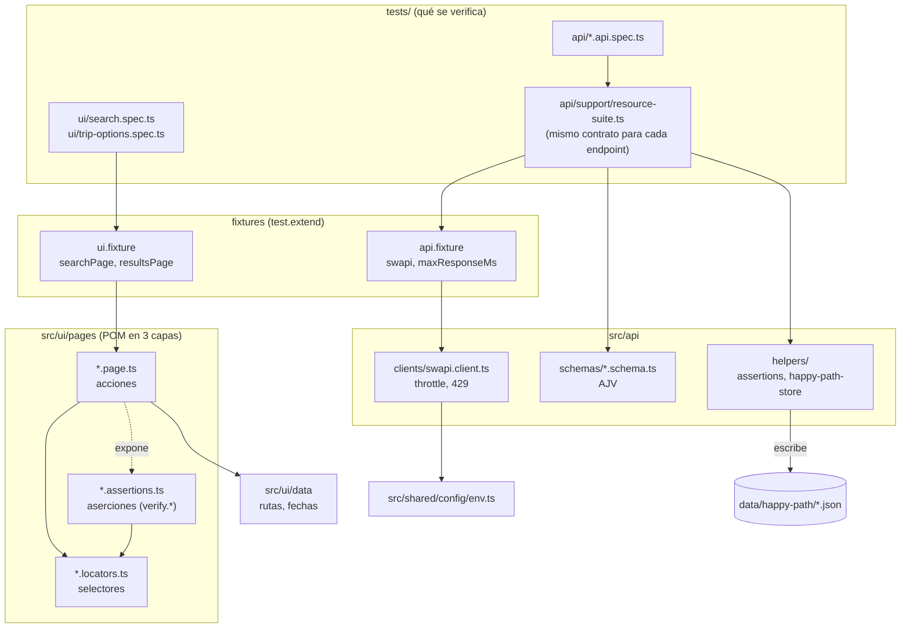
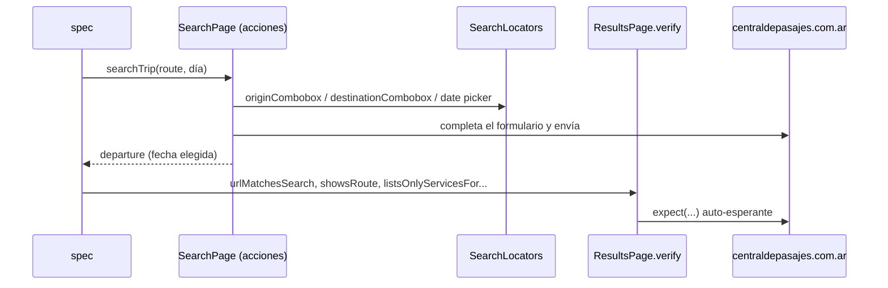
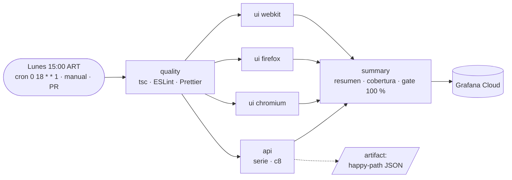

# Beilox QA Automation Challenge

[](https://github.com/AlanEDiaz/Beilox-Challange/actions/workflows/ci.yml)

Suite de automatización con **Playwright + TypeScript (strict)** que cubre **UI web** (centraldepasajes.com.ar) y **API** (swapi.tech) en un único proyecto, con CI en GitHub Actions, reportes de cobertura y un dashboard en Grafana Cloud.

|            |                                                                                                                        |
| ---------- | ---------------------------------------------------------------------------------------------------------------------- |
| UI         | 17 tests × 3 navegadores (Chromium, Firefox, WebKit)                                                                   |
| API        | 16 tests sobre `/people`, `/planets`, `/films` (schemas AJV)                                                           |
| CI         | Todos los lunes 15:00 ART (`cron: 0 18 * * 1`), manual y en PR                                                         |
| Cobertura  | Requisitos × navegador, contrato API × endpoint y líneas de código del framework                                       |
| Documentos | [Plan de pruebas](TEST_PLAN.md) · [Dashboard Grafana](dashboards/grafana-qa.json) · [JSON happy path](data/happy-path) |

## Índice

1. [Cumplimiento del challenge](#1-cumplimiento-del-challenge)
2. [Cómo ejecutar](#2-cómo-ejecutar)
3. [Arquitectura](#3-arquitectura)
4. [Decisiones técnicas](#4-decisiones-técnicas)
5. [Estrategia de pruebas y cobertura](#5-estrategia-de-pruebas-y-cobertura)
6. [CI/CD y dashboard](#6-cicd-y-dashboard)
7. [Cómo escalaría el workflow](#7-cómo-escalaría-el-workflow)
8. [Uso de IA y MCP servers](#8-uso-de-ia-y-mcp-servers)
9. [Preguntas teóricas](#9-preguntas-teóricas)
10. [Limitaciones y trade-offs](#10-limitaciones-y-trade-offs)

---

## 1. Cumplimiento del challenge

| Requisito del brief                                                    | Dónde está                                                                                                                              |
| ---------------------------------------------------------------------- | --------------------------------------------------------------------------------------------------------------------------------------- |
| Búsqueda válida, sin resultados, datos inválidos, volver atrás         | [`tests/ui/search.spec.ts`](tests/ui/search.spec.ts)                                                                                    |
| Resultados coherentes con los parámetros                               | `resultsPage.verify.*` (ruta, fecha, pasajeros, tarjetas) y [`tests/ui/trip-options.spec.ts`](tests/ui/trip-options.spec.ts)            |
| Page Object Model con selectores, acciones y aserciones separados      | [`src/ui/pages/*`](src/ui/pages): `*.locators.ts`, `*.page.ts`, `*.assertions.ts`                                                       |
| TypeScript estricto, sin `any`                                         | [`tsconfig.json`](tsconfig.json) (`strict`, `noUncheckedIndexedAccess`, `exactOptionalPropertyTypes`) + ESLint `no-explicit-any: error` |
| API: 3 endpoints, happy path y errores, status + body + tiempo         | [`tests/api/support/resource-suite.ts`](tests/api/support/resource-suite.ts) (4 a 6 tests por endpoint)                                 |
| Schemas con AJV                                                        | [`src/api/schemas`](src/api/schemas) + [`schema-validator.ts`](src/api/helpers/schema-validator.ts)                                     |
| Body del happy path en JSON                                            | [`data/happy-path/*.json`](data/happy-path), generado en cada corrida                                                                   |
| Fixtures propias con `test.extend`                                     | [`ui.fixture.ts`](src/ui/fixtures/ui.fixture.ts), [`api.fixture.ts`](src/api/fixtures/api.fixture.ts)                                   |
| Sin `waitForTimeout`, aserciones auto-esperantes                       | ESLint `playwright/no-wait-for-timeout: error`; solo `expect(...)` web-first                                                            |
| Credenciales por `.env`, nunca commiteadas                             | [`.env.example`](.env.example); `.env` ignorado; secrets de CI en GitHub                                                                |
| GitHub Action lunes 15:00 ART: instala, corre UI + API, genera el JSON | [`.github/workflows/ci.yml`](.github/workflows/ci.yml)                                                                                  |
| Cómo escalar el workflow                                               | [Sección 7](#7-cómo-escalaría-el-workflow)                                                                                              |
| IA + MCP: ≥2 MCP, un caso sin IA, un MCP propuesto                     | [Sección 8](#8-uso-de-ia-y-mcp-servers)                                                                                                 |
| 6 preguntas teóricas                                                   | [Sección 9](#9-preguntas-teóricas)                                                                                                      |

## 2. Cómo ejecutar

Requisitos: **Node ≥ 24** (el CI usa 24; los scripts de `scripts/` corren TypeScript directo, sin build).

```bash
npm ci
npx playwright install --with-deps      # chromium, firefox y webkit
cp .env.example .env                    # opcional: los valores por defecto funcionan
```

### Suite de UI

```bash
npm run test:ui                         # 3 navegadores
npm run test:ui:chromium                # solo Chromium (rápido)
npx playwright test --project=ui-firefox
npx playwright test --project=ui-chromium --grep @smoke      # solo smoke
npx playwright test --project=ui-chromium --headed --debug   # depuración
```

### Suite de API

```bash
npm run test:api                        # serie (--workers=1), ver decisión 4.5
```

### Reportes, calidad y cobertura

```bash
npm run report                          # abre el reporte HTML de la última corrida
npm run quality                         # tsc --noEmit + ESLint + Prettier
npm run coverage                        # API + UI (3 navegadores) con cobertura (~4 min)
npm run coverage -- chromium            # idem solo con Chromium
```

`npm run coverage` deja el resumen en `coverage/summary.json` y el detalle en `coverage/c8/`. Con un solo navegador, las columnas de Firefox y WebKit aparecen como no cubiertas: es correcto, no se ejecutaron.

Variables de entorno (todas opcionales):

| Variable              | Default                               | Uso                                            |
| --------------------- | ------------------------------------- | ---------------------------------------------- |
| `SWAPI_BASE_URL`      | `https://www.swapi.tech/api/`         | Base de la API                                 |
| `CDP_BASE_URL`        | `https://www.centraldepasajes.com.ar` | Base de la UI                                  |
| `API_MAX_RESPONSE_MS` | `5000`                                | Presupuesto de tiempo de respuesta por request |

## 3. Arquitectura

### Capas



Regla de dependencias: los specs solo conocen fixtures y datos; las acciones usan locators; los locators no conocen a nadie. Nada instancia page objects dentro de un test.

### Estructura de carpetas

```text
.
├── .github/workflows/ci.yml         # pipeline
├── dashboards/grafana-qa.json       # dashboard importable
├── data/happy-path/                 # bodies del happy path (people, planets, films)
├── scripts/                         # ci-summary, coverage-report, push-metrics, run-coverage
├── src/
│   ├── api/{clients,fixtures,helpers,schemas}
│   ├── ui/{data,fixtures,pages/{search,results}}
│   └── shared/config/env.ts
├── tests/
│   ├── api/ (+ support/resource-suite.ts)
│   ├── ui/
│   └── support/tags.ts              # tags de cobertura tipados
├── playwright.config.ts             # proyectos: api, ui-chromium, ui-firefox, ui-webkit
└── .c8rc.json                       # cobertura V8 del framework
```

### Flujo de un test de UI



## 4. Decisiones técnicas

1. **POM en tres capas.** Selectores (`*.locators.ts`), acciones (`*.page.ts`) y aserciones (`*.assertions.ts`, expuestas como `page.verify.*`). Si el sitio cambia un selector se toca un archivo; el spec sigue leyéndose como el caso de negocio.
2. **Fixtures en vez de `new Page()`.** `test.extend` inyecta `searchPage`, `resultsPage`, `swapi` y el presupuesto de tiempo. Los tests no construyen nada.
3. **Una sola definición del contrato API.** `defineResourceSuite()` aplica los mismos checks a `people`, `planets` y `films`. Un endpoint nuevo son 6 líneas, y la cobertura por endpoint es pareja por construcción.
4. **Se testea el contrato observado, no el supuesto.** Antes de escribir los tests se sondeó swapi.tech y se documentó lo que difiere de lo esperable:
   - Nunca devuelve **400**: un id inválido (`abc`) responde **404**, y parámetros de paginación inválidos se ignoran (200 con defaults). Los tests fijan ese comportamiento y lo explican en el nombre.
   - `/planets/<id inexistente>` responde `"messsage"` (con tres `s`). El schema acepta ambas claves y el test deja una anotación `known-issue` en lugar de ocultarlo.
   - `?page=abc&limit=-1` devuelve `total_pages: -82` y links con `page=NaN`: bug upstream, anotado, no testeado.
5. **Rate limit de swapi.tech (100 requests por ventana por IP).** Una corrida local con ráfagas en paralelo terminó en `429`. Medidas: ejecución serie (`--workers=1`), separación mínima de 300 ms entre requests, un reintento solo si `retry-after` ≤ 30 s y, si no, falla con un error claro (`rate limit hit (429)`), de modo que un throttling nunca se confunde con una regresión de contrato.
6. **Presupuesto de tiempo configurable (5 s).** La API ronda 1–4 s por la latencia del servicio público; 3 s daba falsos negativos. Se mide el tiempo de respuesta real en cada request.
7. **Datos de UI resilientes.** Precios y horarios cambian a diario: los tests validan estructura, orden y coherencia con los parámetros, nunca valores. Las fechas se calculan hacia adelante (día 15 del mes próximo), así no caducan. El orden por precio/horario se lee de los atributos `data-servicio-valor` / `data-servicio-sale` de cada tarjeta, no del texto.
8. **Particularidades del sitio documentadas en el código:**
   - El botón Buscar tiene `onclick="this.click()"`: en Firefox el click no termina mientras navega, por eso `submit()` usa `noWaitAfter` y `submitAndWaitForResults()` reintenta con `toPass`.
   - Existe un segundo calendario oculto para la vuelta (`#cdp-calendar-container-regreso`): los locators están acotados al contenedor de ida.
   - La lista de destino se abre sola al elegir origen.
   - Por debajo del breakpoint de escritorio "Ver detalles" queda en un acordeón colapsado: los proyectos usan viewport de escritorio.
9. **Calidad automática.** ESLint con `no-explicit-any`, `no-wait-for-timeout`, `no-force-option`; Prettier; `tsc --noEmit`. Corren en el primer job del pipeline y bloquean el resto.

## 5. Estrategia de pruebas y cobertura

Detalle y matriz de riesgos en [TEST_PLAN.md](TEST_PLAN.md) (la sección 2.1b refleja la exploración final con Playwright MCP).

**Escenarios de UI** (17 por navegador): búsqueda válida y coherencia de resultados; mismo origen y destino (estado vacío "¡Ups!"); formulario vacío, fecha faltante, origen inexistente, fechas pasadas; volver atrás conservando la búsqueda; intercambio de origen/destino; ruta inversa; ida y vuelta (calendario de vuelta bloquea días previos, `FVuelta` en la URL); pasajeros; cambio de día; orden por precio y horario; modal de detalles.

**Escenarios de API** (por endpoint): listado, item (happy path), id inexistente → 404, id no numérico → 404, paginación (people y planets), parámetros inválidos. Cada uno valida status, content-type, estructura (AJV) y tiempo.

### Cobertura: qué significa aquí

Un sitio de terceros no se puede instrumentar. Hablar de "80 % de cobertura" sobre un E2E sin código propio sería engañoso, así que se miden tres ejes concretos, calculados desde lo que **realmente se ejecutó y pasó**:

| Eje                           | Qué mide                                                                                   | Cómo                                                                | Objetivo                                               |
| ----------------------------- | ------------------------------------------------------------------------------------------ | ------------------------------------------------------------------- | ------------------------------------------------------ |
| Requisitos de UI × navegador  | Cada requisito del brief probado en cada motor                                             | Tags `@req-*` en los tests (`tests/support/tags.ts`)                | 100 %                                                  |
| Contrato de API × endpoint    | 8 checks (listado, happy, 404, id inválido, schema, tiempo, JSON, paginación) por endpoint | Tags `@chk-*`                                                       | 100 %                                                  |
| Líneas del framework (`src/`) | Código propio realmente ejercitado                                                         | V8 + [c8](https://github.com/bcoe/c8) con source maps de TypeScript | informativo (97,7 % en la última corrida con Chromium) |

Una celda cuenta como cubierta solo si un test con ese tag **pasó** en ese proyecto. Los dos primeros ejes son un **gate** en CI: si Firefox falla o un test desaparece, la corrida programada se pone en rojo. El tercero es informativo: lo no cubierto son huecos reales (por ejemplo, el reintento ante 429 solo corre cuando hay throttling).

Ejemplo de salida (`npm run coverage -- chromium`, resultado real de esa corrida: Firefox y WebKit no se ejecutaron, por eso figuran como no cubiertos):

```text
API contract coverage: 100% (23/23)
UI requirement coverage: 33.3% (5/15)   <- el valor completo requiere correr los tres navegadores
Framework code coverage: lines 97.69%, branches 91.85%
```

La salida completa se publica en el resumen de cada corrida de Actions, y los tres valores se envían a Grafana.

## 6. CI/CD y dashboard

### Pipeline



- **Horario:** GitHub usa UTC. 15:00 ART (UTC−3, sin horario de verano) = **18:00 UTC** → `cron: '0 18 * * 1'`.
- **Pull requests:** solo Chromium + API (feedback rápido). **Programado/manual:** matriz completa de navegadores, `fail-fast: false` para que un navegador roto no oculte el resultado de los otros.
- **Qué hace cada corrida:** instala dependencias (cache npm), instala navegadores, corre UI + API, genera `data/happy-path/*.json` y lo sube como artifact (falla si no se generó), sube reportes HTML/traces/videos de fallos y publica un resumen con fallidos y _flaky_.
- **Reintentos:** `retries: 2` en CI. Un test que pasa en el reintento queda marcado como _flaky_ en el resumen y en Grafana: no se esconde.
- **Seguridad:** permisos `contents: read`, acciones fijadas por versión, `timeout-minutes` en todos los jobs, `concurrency` para cancelar corridas duplicadas. Ningún secreto en el repositorio.

### Dashboard en Grafana Cloud

Cada corrida programada o manual envía métricas (formato Influx line protocol) con `scripts/push-metrics.ts`. El dashboard [`dashboards/grafana-qa.json`](dashboards/grafana-qa.json) muestra tasa de aprobación, fallidos, _flaky_, duración de la suite, p50/p95 por test y los tres ejes de cobertura, filtrable por suite (`api`, `ui-chromium`, `ui-firefox`, `ui-webkit`).

Configuración (una vez):

1. Grafana Cloud → stack → **Prometheus** → _Details_: tomar la URL base y el _Instance ID_.
2. **Access Policies**: crear una política con scope `metrics:write` y generar un token.
3. Secrets del repositorio (_Settings → Secrets and variables → Actions_):
   - `GRAFANA_INFLUX_URL` = `https://<host-prometheus>/api/v1/push/influx/write`
   - `GRAFANA_INFLUX_USER` = Instance ID
   - `CHALLANGETOKEN` = el token
4. _Dashboards → New → Import_ → subir `dashboards/grafana-qa.json` y elegir el data source Prometheus.

Sin los secrets el paso se omite sin fallar (por ejemplo en forks).

## 7. Cómo escalaría el workflow

No está implementado (el brief lo pide solo como criterio). Hoy, ~70 ejecuciones corren en pocos minutos; con 500 o más tests cambiaría esto:

1. **Sharding de UI.** Dividir cada navegador en shards con `--shard=i/n` y fusionar los reportes `blob` en un job final:

   ```yaml
   ui:
     strategy:
       fail-fast: false
       matrix:
         browser: [chromium, firefox, webkit]
         shard: [1, 2, 3, 4]
     steps:
       - run: npx playwright test --project=ui-${{ matrix.browser }} --shard=${{ matrix.shard }}/4 --reporter=blob
       - uses: actions/upload-artifact@v4
         with: { name: blob-${{ matrix.browser }}-${{ matrix.shard }}, path: blob-report }
   merge-reports:
     needs: ui
     steps:
       - uses: actions/download-artifact@v4
         with: { pattern: blob-*, merge-multiple: true, path: all-blob }
       - run: npx playwright merge-reports --reporter=html ./all-blob
   ```

2. **Matriz por proyecto y por tag.** PR: solo `@smoke` en Chromium + API (minutos). Nightly: regresión completa. Semanal: todos los navegadores. Los tags ya existen (`@smoke`, `@regression`).
3. **API en su propio job con cuota propia.** El rate limit de swapi.tech es por IP: la API sigue en serie y no entra en la matriz de shards. Si hubiese varios servicios, un job por servicio.
4. **Cache y velocidad.** Cache de npm (ya está), cache de `~/.cache/ms-playwright` por versión, runners más grandes solo para los shards pesados.
5. **Secrets y entornos.** Secrets por _environment_ de GitHub (`staging`, `prod-readonly`) con aprobación requerida para los sensibles; pasarlos por `env:` solo al paso que los usa; nunca imprimirlos. OIDC hacia el proveedor cloud en lugar de tokens de larga vida.
6. **Estabilidad.** Cuarentena automática (tag `@quarantine`, corre pero no bloquea) con un ticket por test; el dashboard ya muestra la tasa de _flaky_ por suite.
7. **Aislamiento del entorno.** Entornos de prueba propios o mocks de red para lo que no sea el flujo de negocio: depender de sitios públicos es la mayor fuente de falsos rojos de este proyecto.

## 8. Uso de IA y MCP servers

El proyecto se construyó con **Claude Code** (CLI) como asistente. Lo que sigue describe lo que ocurrió en este repositorio.

### MCP servers usados

| MCP                                                                                                                                   | Para qué lo usé                                                                                                                                                                                         | Qué cambió en el código                                                                                                                               |
| ------------------------------------------------------------------------------------------------------------------------------------- | ------------------------------------------------------------------------------------------------------------------------------------------------------------------------------------------------------- | ----------------------------------------------------------------------------------------------------------------------------------------------------- |
| **Claude in Chrome** (extensión sobre Chrome real)                                                                                    | Primera exploración de centraldepasajes.com.ar: estructura del formulario, descubrimiento de los widgets `select2` (el `<input>` real está oculto), calendario, URL de resultados y DOM de las tarjetas | Los locators de `search.locators.ts` y `results.locators.ts`; el hallazgo de que "Buscar" es `#btnCons`                                               |
| **Playwright MCP** ([microsoft/playwright-mcp](https://github.com/microsoft/playwright-mcp), configurado en [`.mcp.json`](.mcp.json)) | Re-planificación del plan de pruebas con el sitio real: intercambio origen/destino, ida y vuelta, pasajeros, tira de fechas, orden (slim-select sobre `#SelOrder`), modal de detalles                   | Los 10 tests de `trip-options.spec.ts`; correcciones como "el modal nombra distinto a las terminales" y "el cierre es `a.close`, Escape no lo cierra" |

En ambos casos el asistente exploró y los hallazgos se validaron corriendo los tests en los tres navegadores antes de darlos por buenos.

No usé en este challenge: Atlassian MCP, Filesystem MCP ni Git MCP. No los incluyo para sumar cantidad: el criterio pedido es uso concreto.

### Un caso donde decidí NO usar el asistente

Las **credenciales**. El token de Grafana Cloud y los secrets de GitHub los creé yo, a mano, en cada interfaz. El asistente me guió por los pasos y buscó la URL y el Instance ID (datos no secretos), pero nunca generó, vio ni recibió el token. Es una decisión de criterio, no de capacidad: un secreto que pasa por un asistente queda en un historial de conversación que no controlo. Por la misma razón los `git commit` y `git push` los ejecuté yo y no el asistente.

Un segundo caso es de alcance: el asistente podía seguir el flujo hasta la selección de asiento y el pago, pero eso crearía reservas reales en un sitio de producción. Lo dejé fuera del alcance a propósito.

### Un MCP que propongo y no usé

**GitHub MCP.** Caso de uso concreto para el día a día: cuando la corrida del lunes falla, pedirle al asistente que lea los logs y artifacts de esa corrida, la compare con las últimas cuatro y abra un issue con el test, el navegador, el trace adjunto y si ya fue _flaky_ antes. Hoy ese triage lo hago a mano abriendo Actions. Una variante útil complementaria sería el **Grafana MCP**, para consultar la tasa de _flaky_ histórica de un test sin salir del editor.

## 9. Preguntas teóricas

**1. Escalabilidad: la suite creció a 500 tests, ¿qué cambiarías?**
Lo primero es el tiempo de feedback. Dividiría por tags (`@smoke` en cada PR, regresión completa nocturna), haría _sharding_ por navegador y fusionaría los reportes `blob`. Para los tests, movería la preparación de estado de la UI a la API (`storageState`, datos creados por API) para que cada test cubra una sola cosa. En el código, agruparía por dominio (`pages/<dominio>`), extraería componentes compartidos en los page objects y mantendría los tags tipados y la matriz de cobertura para saber qué falta. En organización, `CODEOWNERS` por dominio y una política de cuarentena para _flaky_. Lo que no escala es depender de un sitio público: a esa escala pediría un entorno propio.

**2. Flakiness: un test intermitente sin cambios en el código, ¿cómo lo diagnosticás?**
Primero lo reproduzco: `--repeat-each=20`, en paralelo y en serie, con `trace: on` y mirando el primer paso que diverge. Luego clasifico la causa: espera mal puesta, estado o datos compartidos, dependencia externa (latencia, rate limit), o carrera real del producto. Un caso real de este proyecto: el test de "volver atrás" en Firefox falló una vez en la corrida con tres navegadores en paralelo y no se reprodujo en 9 reejecuciones aisladas; es síntoma de latencia bajo carga, no de un selector malo. Antes de `skip`: arreglar la espera o el selector, aislar los datos, simular la red si el flujo no es lo que se prueba, y si sigue, cuarentena (corre pero no bloquea) con ticket y dueño, y `test.fixme` con motivo. Los reintentos son para diagnosticar y medir (el resumen los marca como _flaky_), no para esconder el problema.

**3. POM: si el sitio cambia el selector del botón "Buscar", ¿cuántos archivos tocás?**
**Uno**: [`src/ui/pages/search/search.locators.ts`](src/ui/pages/search/search.locators.ts), la propiedad `searchButton` (`#btnCons`). Las acciones (`search.page.ts`) y las aserciones usan esa propiedad, y los specs nunca ven selectores. Eso es lo que justifica separar locators de acciones y aserciones.

**4. IA: si el asistente genera un test que pasa al primer intento, ¿qué chequeás antes de mergear?**
Que pase al primer intento no demuestra que pruebe algo. Reviso: (a) que las aserciones comparen contra algo independiente y no contra lo que el propio test acaba de leer; (b) que **falle** cuando rompo a propósito el dato esperado; (c) que no haya valores hardcodeados que caducan (fechas, precios), esperas fijas ni dependencia del orden; (d) que corra en los tres navegadores y varias veces seguidas; (e) que el nombre diga el comportamiento y no la implementación. Ejemplo real: los primeros tests de UI pasaban en Chromium y WebKit pero Firefox los rompió por el `onclick` del botón; sin correr los tres motores eso habría llegado a CI. El caso en que decidí no usar el asistente está en la [sección 8](#8-uso-de-ia-y-mcp-servers).

**5. ¿Qué responsabilidad de un QA Senior no se puede delegar a un asistente?**
Decidir _qué_ probar según el riesgo y qué significa "correcto" (el oráculo): el asistente puede escribir el test, pero no sabe qué importa al negocio. Ejemplos de este proyecto: decidir que un `404` ante un id inválido es el contrato real de swapi.tech y documentarlo como discrepancia, en vez de forzar un `400` que el brief sugería; decidir que mismo origen y destino es un caso de "sin resultados" y no de validación. También la responsabilidad sobre el entorno y los datos reales (no crear reservas en producción), el manejo de credenciales, interpretar si una falla es bug, flaky o infraestructura, comunicar el riesgo residual a quien decide el release, y reconocer lo que el suite no cubre.

**6. CI/CD: si los tests fallan cada lunes a las 15:00 por un problema transitorio de red, ¿cómo lo manejás?**
Distingo transitorio de real antes de reaccionar. Capa 1: `retries` en el test para microcortes (ya está: 2). Capa 2: un chequeo previo de salud del destino; si el sitio o la API no responden, la corrida se marca como "entorno caído", no como fallo del producto. Capa 3: reintentar el job completo una vez antes de alertar. No descartaría la corrida en silencio: queda registrada con sus artifacts, y la tasa de _flaky_ y el historial viven en el dashboard. Alertaría al equipo solo si falla después de los reintentos o en dos lunes seguidos, con un issue automático que adjunte el trace. Si el patrón es siempre el lunes a las 15:00, eso ya no es transitorio: investigaría el horario (cuota, mantenimiento, rate limit por IP compartida del runner) y movería la ventana. Hoy el pipeline implementa las capas 1 y la detección explícita de `429`; el chequeo de salud y las alertas automáticas están en el [backlog](#10-limitaciones-y-trade-offs).

## 10. Limitaciones y trade-offs

- **Dependencia de dos servicios públicos.** Es un compromiso del challenge. El sitio puede cambiar su markup, mostrar un banner o cambiar horarios sin aviso; los tests son resilientes a datos pero no inmunes al rediseño.
- **Rate limit de swapi.tech.** La API corre en serie y con espera entre requests; por eso es el job más lento por test.
- **Flakiness conocida en Firefox bajo carga.** En la última corrida local completa con los tres navegadores en paralelo pasaron 50 de 51 tests; el fallo (volver atrás en Firefox) no se reprodujo al aislarlo. El CI lo contabiliza como _flaky_ y el dashboard lo muestra; todavía no hay cuarentena automática.
- **Solo escritorio.** No hay proyecto móvil: en viewport chico el sitio cambia la estructura (acordeón de tarjetas).
- **Fuera de alcance:** selección de asiento, checkout y pago (crearían reservas reales en producción), regresión visual y pruebas de carga.
- **Sin verificar en este repositorio:** el pipeline completo con los tres navegadores en `ubuntu-latest`; pasó localmente con Chromium, y Firefox/WebKit en Windows, no en el runner de Linux.
- **Backlog:** notificación automática de fallas (issue/Slack), dashboard estático en GitHub Pages, chequeo de salud previo, cuarentena con tag, sharding.
